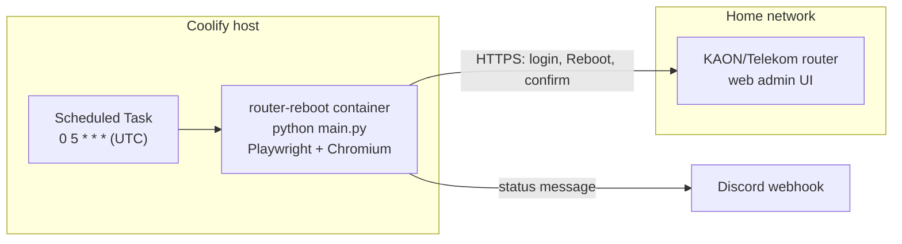

# Router restarter (KAON / Telekom)

Playwright script that logs into a KAON/Telekom home router, reboots it daily and reports status to Discord.



## Features

- Headless Chromium (Playwright): logs in, opens the reboot submenu, clicks "Reboot"
- Step-by-step logs on stdout (visible in Coolify runtime logs), secrets redacted
- On failure: dumps page URL, visible buttons and text to the log
- Discord notification on every run
- Exit code 1 on failure
- Runs on Coolify, plain Docker or Kubernetes

## Configuration

| Variable | Default | Notes |
|---|---|---|
| `ROUTER_URL` | `https://192.168.0.1` | Router admin URL |
| `ROUTER_USERNAME` | `admin` | |
| `ROUTER_PASSWORD` | none | Required, secret (plain text, not base64) |
| `DISCORD_WEBHOOK_URL` | none | Optional, secret |
| `LOG_LEVEL` | `INFO` | `DEBUG` adds browser console output |
| `DRY_RUN` | off | `1`: log in and dump the admin page, no reboot clicks |

## Usage

Local (warning: this reboots the real router):

```bash
pip install -r requirements.txt
playwright install chromium
cp .env.example .env   # fill in values
python main.py
```

Docker Compose (container idles; run the script via exec):

```bash
docker compose up -d --build
docker compose exec router-reboot python /app/main.py
```

Tests:

```bash
python -m unittest
```

## Deployment

### Coolify (primary)

1. New resource, Docker Compose build pack, point at this repo.
2. Add `ROUTER_URL`, `ROUTER_USERNAME`, `ROUTER_PASSWORD`, `DISCORD_WEBHOOK_URL` as environment variables (mark password and webhook as secret).
3. Add a Scheduled Task: name `router-reboot`, command `python /app/main.py`, frequency `0 5 * * *` (Coolify server time, UTC).

Resource limits (set in `docker-compose.yaml`):

| Key | Value |
|---|---|
| `mem_limit` | `1g` |
| `cpus` | `1.0` |
| `pids_limit` | `256` |

### Kubernetes (legacy)

See `router-reboot-cronjob.yaml` and `router-reboot-secret.yaml` (CronJob, daily 03:00, namespace `tools`).
The image CMD is `sleep infinity`, so the CronJob container must set:

```yaml
command: ["python", "/app/main.py"]
```

## Contributing

Pull requests welcome; open an issue first for major changes.

## License

[MIT](https://choosealicense.com/licenses/mit/)
